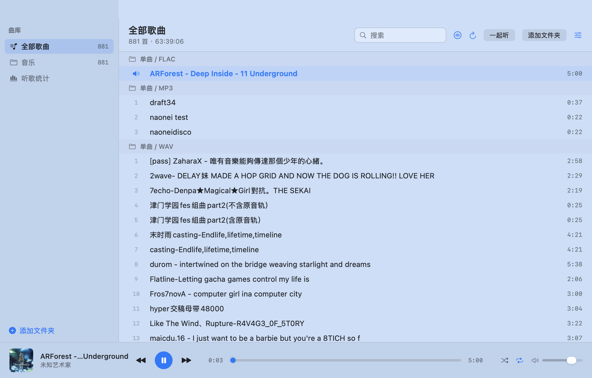
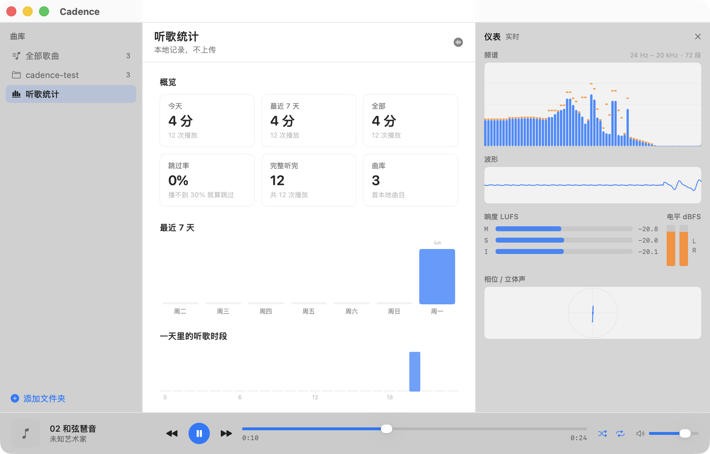
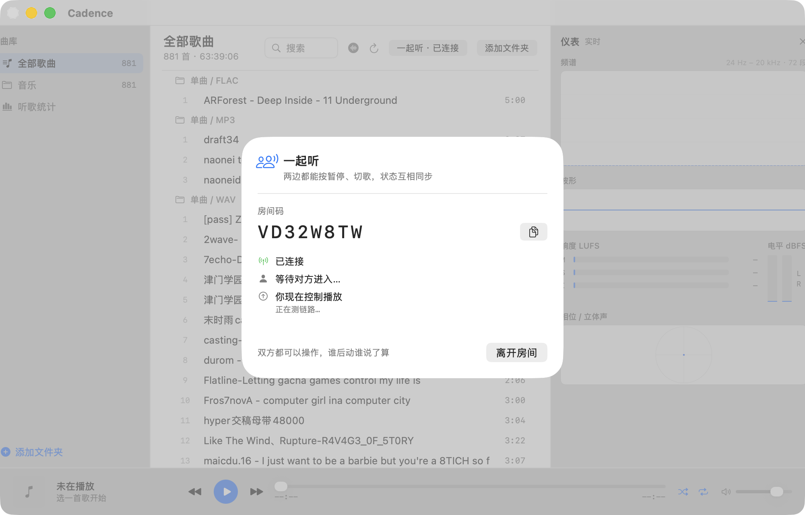
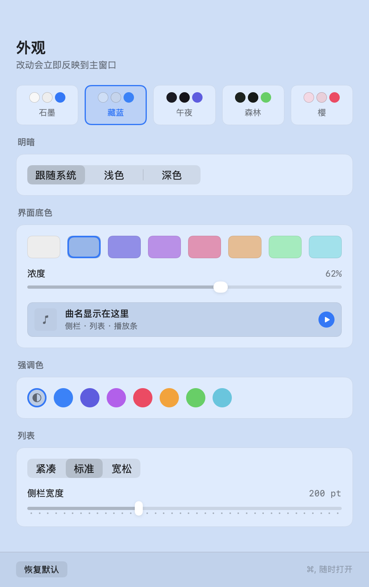

# Cadence

一个给自己用的 macOS 音乐播放器，用来替代 QuickTime Player 听歌。
核心区别：**它认识"文件夹"，而不是一次只认一个文件。**



## 功能

**播放**

- 添加音乐文件夹（可加多个），递归扫描 mp3 / m4a / aac / wav / aiff / flac / alac / caf
- 自动连播：一首放完自动下一首，不用手动开文件
- 循环三态：顺序播放 → 列表循环 → 单曲循环（一个按钮循环切换）
- 随机两档：
  - **洗牌随机**：一轮内绝不重复，洗完一轮才重洗
  - **真随机**：每次独立抽取，可能连着放同一首
- 上一首 / 下一首 / 进度拖动 / 音量
- 搜索过滤，按子文件夹分组显示
- 读 ID3 标签：歌名、歌手、时长、封面（读不到就退回文件名）
- 记住曲库、音量、循环和随机模式

**仪表盘（⌘M）**

只测 Cadence 自己播出来的声音，不抓系统里其他 App 的音频。
播放引擎用 `AVAudioEngine`，从播放节点上挂 tap 取 PCM 流，再交给 Accelerate 算：

- **频谱**：2048 点 FFT，Hann 窗，24Hz–20kHz 对数分 72 段，带峰值保持
- **波形**：峰值抽取的包络，不是简单抽点
- **响度 LUFS**：BS.1770 K 加权，M（400ms）/ S（3s）/ I（整首带门限）
- **电平 dBFS**：左右声道峰值 + 峰值保持
- **相位 / 立体声**：Lissajous 散点，越靠中间越单声道

**听歌统计（⌘T）**

- 今天 / 最近 7 天 / 全部 的听歌时长与次数
- 跳过率（播不到 30% 算跳过）
- 最近 7 天柱状图、24 小时时段分布
- 听得最多的 10 首
- 最近两个月没碰过的曲子

数据存在 `~/Library/Application Support/Cadence/stats.db`（SQLite），不联网。
判断"一首"用的是文件绝对路径；**改名或移动文件会被当成新歌**，这是已知缺陷。



**一起听（⇧⌘J）**

和朋友同时听同一首歌。**声音不走网络**——两边各自播放本地的那一份，只交换几十字节的播放状态。

- 房间码 8 位：一方点「创建房间」，另一方输码进入
- 双向控制：谁按暂停、切歌、拖进度，对面都跟着变
- 走公共 MQTT 中转（默认 `broker.emqx.io:8883`），不需要服务器，不需要账号
- 用「时长 + 文件名」匹配曲目；对不上就静音，并在面板里显示对方在放什么
- 中转地址可配置：`defaults write local.cadence.player syncBroker <主机名>`



### 同步是怎么做的

**1. 传状态，不传命令。** 每条消息带的是「哪首歌、第几秒、播还是停、我的版本号」。
「暂停」这种命令只在发出那一刻成立，晚到 1 秒就错了；而绝对状态任何时刻收到都能自己算出该在哪。

**2. 不需要协调者。** 谁改了状态就把版本号 +1，接收方只认版本号大的；
版本号相同就比设备 ID，两边会算出同一个赢家，不会各说各话。

**3. 不猜两台的时钟差。** 这一条是实测逼出来的：公共中转单程延迟约 250ms、抖动能到 1 秒，
一开始用 ping/pong 估时钟偏差，实测错了 1.2 秒。改成直接对齐「位置 ↔ 本地时刻」——
每条心跳记一个 `(位置 − 本地时刻)`，取最近 32 条里最大的那个。
延迟越小这个值越大，所以取最大值等于自动挑出链路最顺的那一条，抖动被自然过滤掉。

**4. 能不动就不动。** 只有对方主动拖动、切歌、恢复播放（位置连续性检测，偏差 > 1.2 秒），
或者持续跑偏超过 0.35 秒时才纠偏；跳转前有 8ms 淡出、20ms 淡入，遮住波形断裂。

实测（跨公网、14 秒连续跟随）：一次初始对齐 + 一次纠偏，之后稳定在 ±0.02 秒。

## 外观设置（⌘,）

整窗口的配色都由一层主题算出，不是系统灰。改一处，主窗口立即跟着变。

**一键配色**：石墨（原中性灰）/ 藏蓝 / 午夜 / 森林 / 樱，点一下整套换掉。

**逐项调**

| 项 | 范围 | 说明 |
| --- | --- | --- |
| 明暗 | 跟随系统 / 浅色 / 深色 | 直接设 `NSApp.appearance`，标题栏和面板一起变 |
| 界面底色 | 8 个色相 + 浓度滑条 | 浓度 0 就是原来的中性灰；0.6 左右能明显看出色相 |
| 强调色 | 跟随系统 + 7 个预设 | 播放按钮、进度条、选中行、滑块都跟着换 |
| 列表密度 | 紧凑 / 标准 / 宽松 | 同时改行高和字号 |
| 侧栏宽度 | 150–300 pt | |

配色算法：每个表面（窗口 / 侧栏 / 卡片 / 凹陷 / 分隔线 / 进度槽）各有一个亮度，
再乘上「浓度 × 该层可容纳的饱和度」得到最终颜色。深色模式下颜色感知更钝，
饱和度乘 1.4 做补偿，否则深色蓝调几乎看不出来。

设置存在 `local.cadence.player` 的 `theme.*` 键里，重启保持。



**几个刻意的取舍**

- 色板用醒目的中间调，不按实际背景色绘制——后者在深色模式下会全糊成一片黑。
  真实观感由色板下方的预览条和主窗口呈现。
- 进度条是自绘的（`ProgressBar`），没用系统 `Slider`。系统滑轨在深色和彩色背景上几乎看不见，
  被挤压时还会退化成一个孤零零的圆点。
- 进度槽单独有个颜色（`groove`）：深色下比背景亮、浅色下比背景暗。用同一个"凹陷色"两头都不讨好。

## 快捷键

| 操作 | 键 |
| --- | --- |
| 播放 / 暂停 | 空格 |
| 下一首 | → |
| 上一首 | ← |
| 打开仪表盘 | ⌘M |
| 打开听歌统计 | ⌘T |
| 外观设置 | ⌘, |
| 一起听 | ⇧⌘J |
| 添加文件夹 | ⌘O |
| 重新扫描 | ⌘R |
| 切换循环模式 | ⌘L |
| 切换随机模式 | ⇧⌘S |
| 音量 ± | ⌘↑ / ⌘↓ |

鼠标：点一下列表里的歌就播；右键可以"在访达中显示"；文件夹可以直接拖进窗口。

## 安装与重新编译

```bash
git clone https://github.com/<your-name>/Cadence.git
cd Cadence
./build.sh                          # 输出 Cadence.app
cp -R Cadence.app /Applications/    # 安装
```

不需要 Xcode，只要 Command Line Tools（`xcode-select --install`）。`swiftc` 直接编译，ad-hoc 签名，没有第三方依赖。
本项目只针对 Apple Silicon（`-target arm64-apple-macos14.0`）；要在 Intel 机器上跑，把 `build.sh` 里的 target 改掉即可。

调试用启动参数（正常双击不会触发）：

```bash
./Cadence.app/Contents/MacOS/Cadence --debug-autoplay          # 启动即播第一首
./Cadence.app/Contents/MacOS/Cadence --apply-scheme navy       # 直接套用某套配色
./Cadence.app/Contents/MacOS/Cadence --open-settings           # 启动就打开设置面板
./Cadence.app/Contents/MacOS/Cadence --snapshot /tmp/x         # 把窗口自绘成 png（不需录屏权限）
CADENCE_DEBUG=1 ...                                             # 同时把事件写进 /tmp/cadence.log
```

## 目录结构

```
Cadence/
├── Sources/
│   ├── App.swift           入口 + 菜单命令
│   ├── Models.swift        Track 模型、文件夹扫描、标签读取
│   ├── PlayerModel.swift   播放状态机（AVAudioEngine / 队列 / 循环 / 随机 / 统计记录）
│   ├── AudioAnalyzer.swift 环形缓冲 + FFT + LUFS + 电平 + 相位
│   ├── MetersView.swift    仪表盘界面 + 60fps 刷新
│   ├── StatsStore.swift    SQLite 入库与聚合查询
│   ├── StatsView.swift     统计页面
│   ├── MQTTClient.swift    极简 MQTT 3.1.1 客户端（TLS + 订阅 + 发布）
│   ├── SyncEngine.swift    一起听：房间、版本合并、位置对齐
│   ├── SyncView.swift      一起听面板
│   ├── Theme.swift         主题：配色算法、预设、持久化
│   ├── SettingsView.swift  外观设置面板
│   └── ContentView.swift   主界面
├── Info.plist
├── AppIcon.icns
├── makeicon.swift          图标生成脚本
└── build.sh
```

## 已知限制

- **Apple Music 下载的 .m4p 放不了**，那是 FairPlay 加密，第三方播放器都解不开。
- 只在本机可用。ad-hoc 签名没有公证，拷给别人会被 Gatekeeper 拦。
- 仪表里的"峰值"是采样峰值，不是 4 倍过采样的真峰值（true peak），所以标的是 dBFS 而不是 dBTP。
- K 加权用的是 48kHz 标准系数。44.1kHz 音频的 LUFS 读数会有零点几 dB 的偏差，看相对值没问题。
- 统计按文件路径识别曲目，改名/移动后会断链。
- 暂不支持键盘媒体键、控制中心显示、双击音频文件打开。
- 文件夹里新增歌曲要按 ⌘R 或点刷新，还没做实时监听。
- 一起听依赖公共中转：中转关停或限速就用不了，换地址才能恢复。
- 一起听是"公共房间"：房间码被猜到就能看到你在听什么。传输走 TLS，但房间里没有鉴权。
- 一起听的同步是"位置对齐"而非"逐样本对齐"：两边都稳定地落后中转延迟（约 0.1–0.25 秒），
  但这个滞后对两边是一致的，各自戴耳机听不出来；同一个房间里放同一首会听到轻微回声。
- 一起听对方切歌/暂停时，你这边会滞后 0.25–1 秒才跟上，这是不架服务器的代价。
- 一起听要求两边有同一个文件（按文件名 + 时长匹配），文件不同名就对不上。
- 强调色只作用于 app 自己画的东西；系统弹出的窗口（打开文件、菜单、右键菜单）仍是系统强调色。
